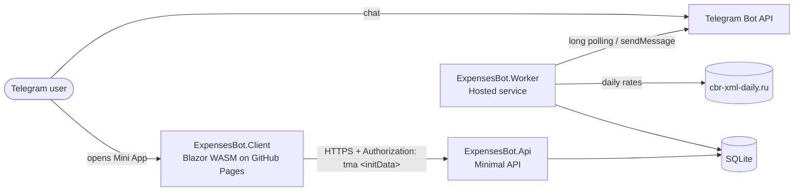

# ExpensesBot

[](https://github.com/runolight/ExpensesBot/actions/workflows/ci.yml)

A personal finance tracker that lives inside Telegram: a chat bot for quick
entries and a Blazor WebAssembly **Telegram Mini App** for everything else.
Built with .NET 10, ASP.NET Core Minimal APIs and EF Core.

> The user interface and bot messages are in Russian; the code and docs are in English.

## What it does

- **Record in two taps** — send `1500 кофе`, `+50000 зарплата` or `20$ такси` to the bot; it parses amount, currency, type and note, then offers category buttons with its best guess first.
- **Mini App dashboard** — income, expenses and balance converted into one display currency; spending by category and by month; search, filter, sort.
- **Multi-currency** — AMD, USD and RUB with daily rates from the Central Bank of Russia.
- **Budgets** per category or overall, with a Telegram alert at 90%.
- **Savings goals** with contributions and progress.
- **Recurring transactions** (daily / weekly / monthly / yearly), income or expense, executed automatically.
- **Shared wallets** — a family budget: invite people by code or `t.me/<bot>?start=join_CODE`, record transactions into the wallet, see who spent what; the other members get a message about each entry.
- **Tags**, **CSV export and import** (the export can be re-imported).
- **Undo** — a ↩️ button under every entry recorded from the chat, and `/undo` for the latest one.
- **Notifications** — evening reminder, weekly report, budget alerts, shared-wallet entries; `/report` in chat.

## Frontend

The Blazor client is plain Razor components and two stylesheets: no CSS framework, no SCSS, no build step.

| File | Purpose |
|---|---|
| `wwwroot/css/tokens.css` | Design tokens: colours, typography, radii, shadows. One `.expenses-app.dark` block overrides them for the dark theme. |
| `wwwroot/css/app.css` | Base styles and component styles (BEM: `card`, `card__header`, `btn--primary`), plus Blazor's loading and error UI. |
| `wwwroot/js/telegram.js` | Telegram Mini App bridge (`initData`, start parameter, theme, native confirm dialogs) and CSV file helpers. |

`Pages/Home.razor` composes the page and owns the data; each panel in `Components/` owns its own form and open/closed state and reports back through callbacks.

| Component | Purpose |
|---|---|
| `AppHeader` | Title, display currency, help, theme, import and account actions |
| `HelpModal` | In-app guide: bot notifications, bot commands, currencies, recurring rules, budgets, goals |
| `Modal` | Overlay + card with title, close button and optional action buttons |
| `PanelHeader` | Panel title with an add/close toggle and optional extra buttons |
| `TypeToggle`, `CurrencySelect`, `CategorySelect` | Form inputs shared by every form (`@bind-Value`) |
| `ProgressCard`, `ProgressBar` | Budget and goal cards with a coloured progress bar |
| `BarRow`, `PieChart` | Breakdown charts (hand-rolled SVG, culture-invariant) |
| `TagSelector`, `TagChip` | Tag picking and creation in the transaction form; read-only tag labels in history |
| `TransactionList`, `SearchFilterBar` | History with client-side search, category and tag filters, and sort |
| `EmptyState`, `ErrorBanner` | Placeholders and dismissible errors |

Conventions: colours come from tokens, never inline styles except data-driven values (bar widths, tag colours via `--tag-color`); confirmations go through `IJSRuntime.ConfirmAsync`, which uses Telegram's native dialog inside the Mini App.

## Architecture



| Project | Responsibility |
|---|---|
| `ExpensesBot.Api` | REST API. `Authentication/` — ASP.NET Core authentication handler for Telegram `initData`; `Application/` — one service per feature (transactions, summary, budgets, goals, …) returning `Result<T>`; `Endpoints/` — thin Minimal API mappings; `Contracts/` — request/response records. Applies EF Core migrations on startup. |
| `ExpensesBot.Client` | Blazor WebAssembly Mini App, deployed to GitHub Pages. |
| `ExpensesBot.ServiceDefaults` | Shared host setup (the Aspire "service defaults" pattern): Serilog, OpenTelemetry traces and metrics, `/health` and `/alive`. |
| `ExpensesBot.AppHost` | .NET Aspire AppHost: runs the API, the Worker and the client together with the Aspire dashboard (local development only). |
| `ExpensesBot.Data` | EF Core model, migrations, and shared rules: supported currencies, new-user defaults, database path resolution. |
| `ExpensesBot.Worker` | Telegram bot (long polling), recurring transactions, scheduled notifications, the outbox dispatcher, exchange-rate updates. |
| `*.Tests` | xUnit tests: API integration tests on in-memory SQLite, bUnit component tests, Worker and Data unit tests. |

## Design decisions

- **Money is stored as `long` minor units** (cents/luma) together with an ISO currency code. No floating-point rounding errors; conversions round once, explicitly.
- **Authentication without passwords.** The Mini App sends Telegram's signed `initData`; the API checks the HMAC-SHA256 signature with the bot token ([Telegram docs](https://core.telegram.org/bots/webapps#validating-data-received-via-the-mini-app)), rejects stale data, and creates the user on first visit. See `TelegramInitDataValidator`.
- **Standard ASP.NET Core auth pipeline.** `TelegramAuthenticationHandler` turns a valid `initData` into a `ClaimsPrincipal` (creating the user on first visit); route groups use `.RequireAuthorization()` and endpoints just read `user.GetUserId()`.
- **Thin endpoints, testable services.** Business rules live in application services that return `Result<T>` instead of throwing; endpoints map results to HTTP, and errors are returned as RFC 9457 problem details. Services are unit-tested directly against SQLite, without HTTP.
- **Development login is Development-only.** For local work the API also accepts `X-Dev-User-Id`, but only when `ASPNETCORE_ENVIRONMENT=Development`, and Release builds of the client never send it. A test starts the API as Production and checks that the header is ignored.
- **Cross-currency totals are converted, never summed raw.** The summary endpoint converts every transaction into the requested display currency using the latest stored rates (with clearly flagged fallback rates if none are stored yet).
- **The bot is stateless.** One handler serves every chat, so type, amount, currency and category travel inside the button's `callback_data` (`tx:e:1500:AMD:12`, at most 64 bytes). The note doesn't fit, so the bot's question is sent as a reply to the user's message and the handler re-parses the note from `reply_to_message`. The confirmation message is edited after recording, so a second tap can't create a duplicate.
- **Free-form input is a pure function.** `BotEntryParser` (regex: amount first or last, sign, currency symbol or word, `к`/`тыс` multiplier) and `CategoryGuesser` (same note before → category name in the note → keywords) have no I/O and are covered by table-driven tests.
- **Resource-level authorization for shared wallets.** Authentication says who the user is; `WalletService` decides per wallet: non-members get 404 (existence isn't revealed), members can read and record, only the owner may rename, re-key the invite, remove members or delete (403). A transaction keeps its author as owner, so personal statistics and edit rights don't change; leaving or deleting a wallet turns its transactions back into personal ones (`ON DELETE SET NULL`). Joining is shared by the API and the bot (`WalletInvites` in the Data project).
- **Creating a transaction is idempotent.** `POST /api/v1/transactions` accepts an `Idempotency-Key` header. The key is stored on the transaction under a unique `(UserId, IdempotencyKey)` index: a repeated request returns the original transaction, a concurrent duplicate loses the race on the index and gets the same answer, and reusing a key for a different amount, currency, type, category or wallet is rejected with 422. The Mini App generates one key per form, so a double tap or a network retry can't record the same entry twice.
- **Notifications go through a transactional outbox.** Nobody calls Telegram in the middle of business logic: the API and the Worker add an `OutboxMessages` row in the same `SaveChanges` as the change it is about (a wallet transaction, a reminder's `NotificationLogs` entry), so a message exists if and only if that change was committed. `OutboxDispatcher`, a separate hosted service in the Worker, delivers due messages, records each outcome right after sending, retries transient failures (network, 5xx, 429 with Telegram's `retry_after`) with exponential backoff up to 8 attempts, and drops permanent ones (bot blocked). A slow Telegram therefore never blocks the bot or an API request.
- **Scheduled notifications are queued once.** Every reminder, weekly report and budget alert is recorded in `NotificationLogs` with a unique `(UserId, Kind, Key)` index, together with its outbox message. The Worker checks it before queueing, so restarts or a second instance never queue the same message twice.
- **Versioned API.** Endpoints are mapped into an `Asp.Versioning` version set under `/api/v{version}` (`/api/v1/transactions`), so the version is visible in logs, links and caches, and a future v2 can live next to v1. Responses list `api-supported-versions`; an unknown version gets 404. `Asp.Versioning.OpenApi` produces one OpenAPI document per version, and a document transformer declares both authentication schemes so Scalar can send authorised requests.
- **Rate limiting on both entry points.** The API uses ASP.NET Core's `AddRateLimiter` with one token bucket per user (per IP before authentication): a burst of 60 requests, because opening the Mini App fires about ten at once, refilled at 120 per minute. Over the limit it answers 429 with `Retry-After` and a problem-details body; health probes are exempt. The bot has its own per-user bucket (burst 10, 30 updates per minute): extra updates are dropped, pressed buttons are still answered so their spinner stops, and the user is told to slow down at most once a minute.
- **Observability through OpenTelemetry.** Both services log through Serilog (readable lines in Development, compact JSON elsewhere) and export traces, metrics and logs over OTLP whenever `OTEL_EXPORTER_OTLP_ENDPOINT` is set, so any OpenTelemetry backend works and the Aspire dashboard works with no extra setup. Traces cover incoming requests, EF Core queries and outgoing HTTP; the Worker, which has no incoming requests, opens its own spans per bot update, maintenance run and outbox delivery. Custom metrics: `expensesbot.transactions.created` (by source: api, bot, recurring), `expensesbot.outbox.attempts` (by kind and outcome), `expensesbot.bot.updates`. Telegram URLs carry the bot token, so the HTTP instrumentation records them with the token masked.
- **Health checks that mean something.** `/health` returns a JSON report for the database (EF Core) and the Telegram Bot API (`getMe`, cached for a minute). Telegram being down makes the API *Degraded*, not *Unhealthy*: the Mini App keeps working, because `initData` is verified offline. `/alive` is a dependency-free liveness probe.
- **One SQLite file, two processes.** The API and the Worker share the database. Relative paths are resolved against the repository root so both open the same file, and both apply migrations at startup under EF Core's migration lock.

## Getting started

### Prerequisites

- [.NET 10 SDK](https://dotnet.microsoft.com/download)
- A Telegram bot token from [@BotFather](https://t.me/BotFather) (only needed for the bot and for real Mini App logins)

### Configuration

| Setting | Used by | Default | Notes |
|---|---|---|---|
| `ConnectionStrings:ExpensesDatabase` | API, Worker | `Data Source=data/expenses.db` | Relative paths resolve against the repo root. |
| `Telegram:BotToken` (or env `TELEGRAM_BOT_TOKEN`) | API, Worker | — | Keep it out of git: use user-secrets or environment variables. |
| `Telegram:WebAppUrl` | Worker | GitHub Pages URL | URL the bot's "Open app" buttons point to. |
| `Telegram:DailyReminderHourUtc` | Worker | `17` | Hour (UTC) of the evening reminder. |
| `Telegram:InitDataMaxAgeHours` | API | `24` | How long a Mini App session stays valid. |
| `Cors:AllowedOrigins` | API | GitHub Pages origin | Add the origin the client is served from. |
| `ApiBaseUrl` (`Client/wwwroot/appsettings*.json`) | Client | `http://localhost:5069/` in Development | Public URL of the API for the deployed client. |
| `RateLimiting:TokenLimit` / `RateLimiting:TokensPerMinute` | API | `60` / `120` | Per-user burst and refill rate. |
| `OTEL_EXPORTER_OTLP_ENDPOINT` | API, Worker | — | Send logs, traces and metrics to an OpenTelemetry collector (the Aspire AppHost sets it). |
| `Serilog:MinimumLevel` | API, Worker | `Information` | Log levels, with per-namespace `Override`s. |
| `BotUsername` (`Client/wwwroot/appsettings.json`) | Client | empty | Bot username for `t.me/<bot>?start=join_CODE` wallet invite links; without it the app shows only the code. |

```bash
# API and Worker share one user-secrets store, so this configures both
# (alternatively export TELEGRAM_BOT_TOKEN)
dotnet user-secrets --project ExpensesBot.Worker set "Telegram:BotToken" "<token>"
```

### Run locally

```bash
dotnet run --project ExpensesBot.Api      # http://localhost:5069 (creates data/expenses.db)
dotnet run --project ExpensesBot.Worker   # bot + background jobs
dotnet run --project ExpensesBot.Client   # http://localhost:5160
```

Or start everything at once with the [.NET Aspire](https://aspire.dev) dashboard, which shows the logs, traces, metrics and health of each service:

```bash
dotnet run --project ExpensesBot.AppHost  # dashboard at http://localhost:15180 (login link in the console)
```

Opened in a normal browser, the Development client signs in as a test user via `X-Dev-User-Id`.
`ExpensesBot.Api/ExpensesBot.Api.http` has ready-made requests.

### Run with Docker

```bash
cp .env.example .env        # set TELEGRAM_BOT_TOKEN (and CLIENT_ORIGIN / WEBAPP_URL if needed)
docker compose up -d --build
```

The API listens on `http://localhost:8080` and the Worker runs the bot; both use one SQLite database on the `expenses-data` volume. Both containers run in Production mode, so the development header is disabled.

### Use it from Telegram

1. Create a bot with @BotFather and set the token as above.
2. Expose the API over HTTPS (for example `cloudflared tunnel --url http://localhost:5069`) and put that URL in `Client/wwwroot/appsettings.json` → `ApiBaseUrl`.
3. **Run the API in Production** (`ASPNETCORE_ENVIRONMENT=Production`) whenever it is reachable from the internet.
4. Deploy the client (the `Deploy` workflow publishes it to GitHub Pages) and register that URL with @BotFather (`/newapp` or the bot's menu button).
5. Send `/start` to the bot.

Bot commands: `/start`, `/menu`, `/expenses` (open the app), `/report` (last 7 days), `/undo` (delete the latest entry after a confirmation), or just send an amount with an optional note (`1500 кофе`, `+50000 зарплата`, `20$ такси`).

## Tests

```bash
dotnet test ExpensesBot.slnx
```

- **Application service tests** exercise summary math, budget and goal progress directly against a migrated in-memory SQLite database with a fixed clock.
- **API integration tests** run the real application (`WebApplicationFactory`) against an in-memory SQLite database created from the migrations. They cover validation, health checks, rate limiting, API versioning and documentation, per-user isolation, idempotent creation (including concurrent duplicates), currency conversion, summary math, goals, CSV export, and authentication with correctly signed, tampered, expired and foreign `initData`.
- **Component tests** (bUnit) cover the summary card, history search/filter/sort, the edit and delete-account dialogs, shared form inputs, goal contributions and the help dialog.
- **Worker and Data tests** cover recurrence scheduling, outbox delivery, retries and backoff, the bot's rate limiter, CBR rate parsing, bot input parsing, currency rules, and a check that the migrations match the EF model.

GitHub Actions runs build and tests on every push and pull request (`.github/workflows/ci.yml`); `deploy.yml` publishes the client to GitHub Pages.

## API overview

| Method | Route | Purpose |
|---|---|---|
| GET/POST/PUT/DELETE | `/api/v1/transactions[/{id}]` | Transactions (paged list with optional `tagId` filter, create with optional `Idempotency-Key`, update, delete) |
| POST | `/api/v1/transactions/bulk` | Create up to 100 transactions, with per-row errors |
| GET | `/api/v1/transactions/summary?mode=all\|30days\|month&currency=AMD` | Totals, breakdowns, average and projection |
| GET | `/api/v1/transactions/export` | CSV export |
| GET/POST/PUT/DELETE | `/api/v1/categories[/{id}]`, `POST /{id}/archive` | Categories |
| GET/POST/PUT/DELETE | `/api/v1/budgets[/{id}]` | Budgets with spent amount and progress |
| GET/POST/PUT/DELETE | `/api/v1/goals[/{id}]`, `POST /{id}/contribute` | Savings goals |
| GET/POST/PUT/DELETE | `/api/v1/recurring[/{id}]`, `POST /{id}/execute` | Recurring rules |
| GET/POST/PUT/DELETE | `/api/v1/tags[/{id}]` | Tags |
| GET/PUT/DELETE | `/api/v1/profile`, `/api/v1/profile/currency` | Profile, default currency, account deletion |
| GET/POST | `/api/v1/exchange/rates`, `/api/v1/exchange/convert` | Exchange rates |
| GET/POST/PUT/DELETE | `/api/v1/wallets[/{id}]`, `POST /join`, `POST /{id}/invite`, `POST /{id}/leave`, `DELETE /{id}/members/{userId}` | Shared wallets and membership |
| GET | `/api/v1/wallets/{id}/transactions`, `/api/v1/wallets/{id}/summary` | Wallet transactions with authors; totals per member and category |

Every route is versioned in the path (`/api/v1/…`). In Development the OpenAPI document is served per version at `/openapi/v1.json` and the [Scalar](https://scalar.com) UI at `/scalar` (choose the `DevUser` scheme and enter any id to try requests). `/health` (JSON report: database, Telegram) and `/alive` are public and unversioned.

## Roadmap

- [ ] Verify the Docker images — `docker compose build` and a smoke run of both containers after the ServiceDefaults project and the Worker's switch to the `aspnet` base image
- [x] Persist notification state so restarts never resend alerts
- [ ] Move to PostgreSQL for multi-instance deployments
- [x] Editing budgets, goals and tags
- [x] Tag filters
- [ ] Voice input — send a voice message like «потратил три тысячи на продукты»; speech-to-text, then the same parser as typed entries
- [x] Idempotent transaction creation — an `Idempotency-Key` header so a double tap or a network retry never creates a duplicate
- [x] Outbox for notifications — the API and the Worker write events to a table; a separate dispatcher delivers them to Telegram with retries
- [x] Observability — OpenTelemetry traces and metrics, structured logging with Serilog, `/health` checking the database and Telegram (possibly via .NET Aspire)
- [x] Rate limiting (`AddRateLimiter`) for the API and the bot
- [x] API versioning and Scalar UI instead of the bare `/openapi/v1.json`
- [ ] Public demo mode — a read-only user with generated data, so the app can be explored without Telegram
- [ ] Screenshots / GIF of the bot and the Mini App in this README

## License

[MIT](LICENSE)
